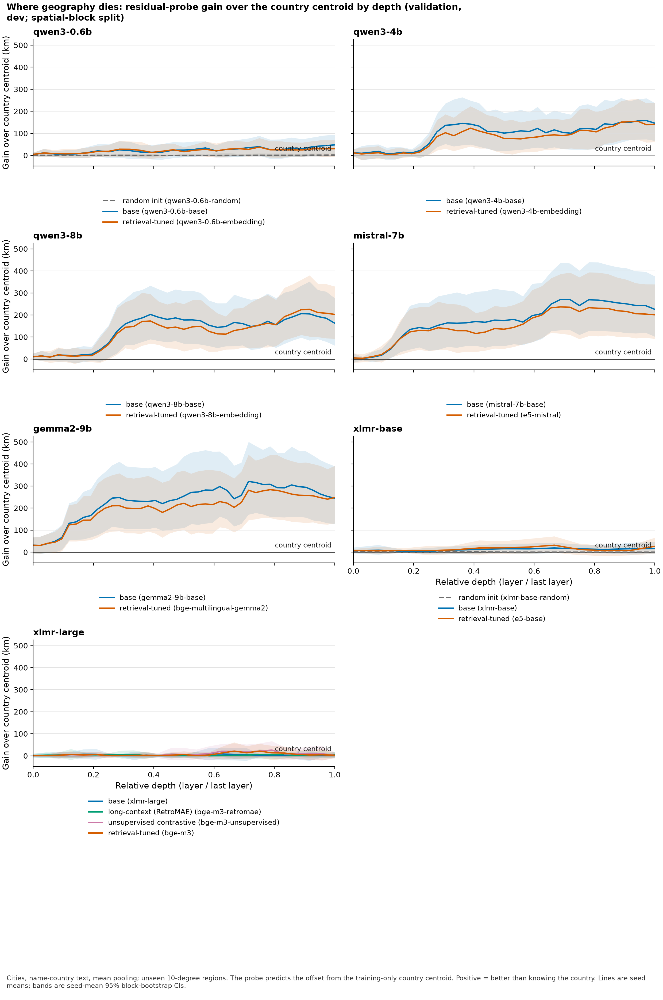
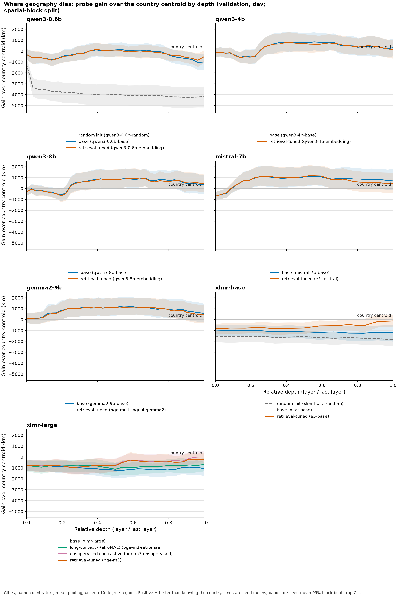
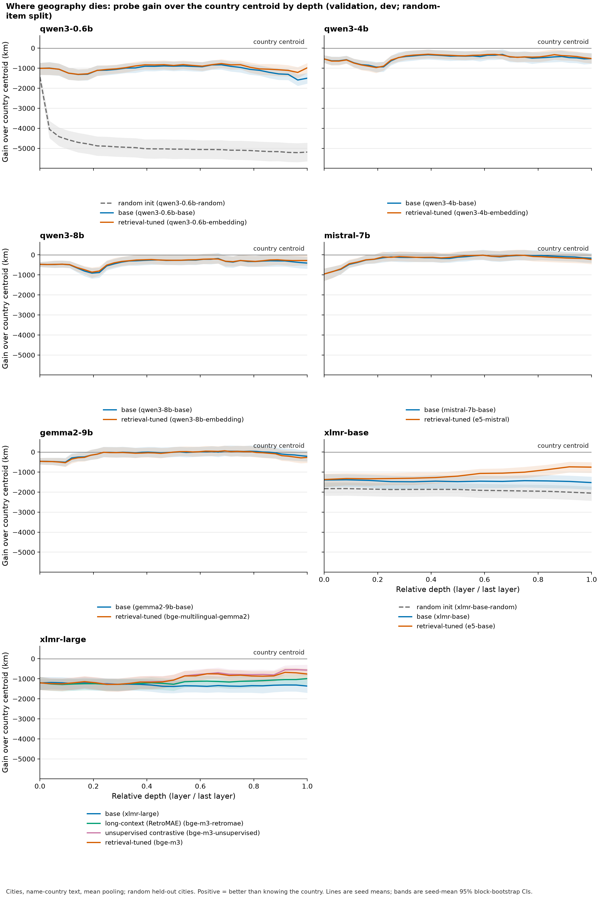
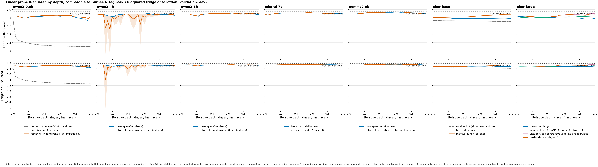
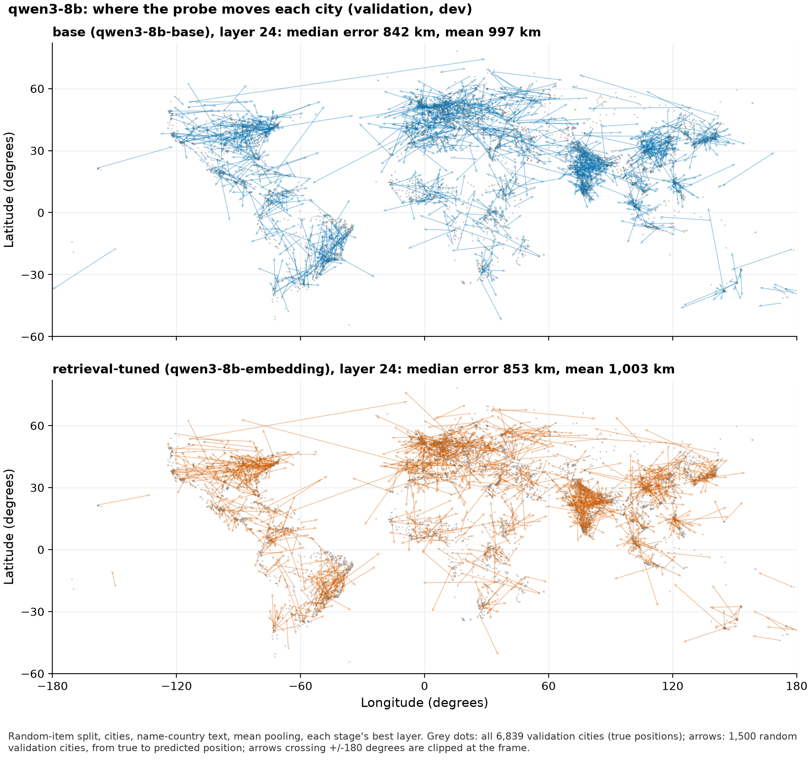

# Progress report — 2026-11-04

A plain-language summary of where the project stands, for the team. Technical run logs live in [`experiments/LAYERS_RUNS.md`](../experiments/LAYERS_RUNS.md); this page explains what they mean.

**Short version.** We built a pipeline that measures, layer by layer, how much geographic information is inside a language model, and ran it on 18 models. Larger decoder models know where a city lies *within its country*, not just which country it is in, and retrieval training (turning a base model into a search-embedding model) does **not** throw that information away. Encoder models (XLM-R, E5, BGE-M3, and the 3.5B XLM-R XL) show at most a small amount. On 2026-11-04 we ran the held-out **test** split once, on a list of layers and claims frozen beforehand; the main findings held (see "Test results" below).

The same day, two further analyses were frozen and tested once each:

- **What search uses.** Retrieval models' search vectors reflect within-country geography more than their base models' do. They reach about a third of the way to the true nearest neighbours.
- **A coordinate-free fix.** An instruction, plus mixing in an earlier layer, plus a small learned distance map, gets search to about half of that ceiling without hurting general text similarity.
- **Fresh towns (fresh-v1).** On 32,148 new GeoNames towns (5,000-14,999 people) that no analysis had touched, the fix still beats plain search, the geographic wording beats the standard similarity instruction, and the fix beats Feuerstein et al.'s coordinate axes. All three held in every run.

## Where the code is

| Branch | What it holds | Status |
|---|---|---|
| `master` | Everything tested so far: explorer, location experiments, layer probes, reflected geography, the coordinate-free fix, the paper results section (PRs #4 and #5) | default branch |
| `research/fresh-places` | Fresh held-out towns: loader, extraction, scoring, freeze and test results (fresh-v1); paper update | done; ready for PR |

All older research branches, including `research/fix-baselines` (PR #6), were merged and deleted on 2026-11-04.

## The question

The proposal asked whether text embeddings encode geography, and whether retrieval training removes geography that the base language model had. The earlier final-embedding experiments (on `master`) found that a linear probe on the *final* embedding barely beats "guess the centre of the station's country". That leaves two possibilities: the information is absent, or it is present in earlier layers and lost or hidden by the end. The layer-wise probes test this directly.

## What we built

- **Data.** 34,196 GeoNames cities (population at least 15,000) and 11,833 radio stations (Radio Browser snapshot of 2026-11-02). Cities are given to the model as text in two forms, `name` ("Lyon") and `name-country` ("Lyon, France"); stations use their metadata with coordinates removed.
- **Models (18 checkpoints).** Each family pairs a *base* model with a *retrieval-tuned* model whose model card names that base, so we can compare before and after retrieval training:

  | Family | Base | Retrieval-tuned | Status |
  |---|---|---|---|
  | Qwen3 0.6B | Qwen3-0.6B-Base (+ random-init control) | Qwen3-Embedding-0.6B | done |
  | Qwen3 4B | Qwen3-4B-Base | Qwen3-Embedding-4B | done |
  | Qwen3 8B | Qwen3-8B-Base | Qwen3-Embedding-8B | done |
  | Mistral 7B | Mistral-7B-v0.1 | e5-mistral-7b-instruct | done |
  | Gemma-2 9B | gemma-2-9b | bge-multilingual-gemma2 | done |
  | XLM-R base | xlm-roberta-base (+ random-init control) | multilingual-e5-base | done |
  | XLM-R large | xlm-roberta-large | BGE-M3 (three training stages: RetroMAE, unsupervised, final) | done |

  EmbeddingGemma is not in the probe study because Google has not released the checkpoint it was trained from.
- **Probes.** For every layer we average the hidden states over the text's tokens (and, for decoders, also take the last token), then fit a ridge regression that predicts the place's location. Three targets:
  - `sphere`: the location as a 3-D point on the unit sphere.
  - `latlon`: latitude and longitude in degrees, so R² is comparable with Gurnee & Tegmark.
  - `country-residual`: the offset from the country's centre. This asks "does the model know *where inside the country* this place is?" and is the most informative probe.
- **Controls.** The baseline everywhere is the *country centroid*: predict the average location of training places from the same country. Gains are reported in km over that baseline (positive = better than knowing the country). Random-init models show what a probe can extract from tokenization alone; shuffled-label probes show chance level.
- **Splits.** `random-item` holds out random places; `spatial-block` holds out whole 10° × 10° regions (harder: the probe must generalize to unseen parts of the map). Three seeds; 95% confidence intervals from a block bootstrap.
- **Validation vs. test.** Places are split 60/20/20 into train/validation/test. Numbers in "Results so far" are validation; the test split was then run once, on frozen claims (see "Test results" below).

## Results so far (validation only)

### 1. Within-country geography appears in every large decoder, and retrieval training keeps it

Country-residual probe, `name-country` cities, km gain over the country centroid at each model's best layer, [95% CI]:

| Family | Base, random-item | Retrieval, random-item | Base, spatial-block | Retrieval, spatial-block |
|---|---|---|---|---|
| Qwen3 0.6B | 12 [-6, 31] | 24 [1, 48] | 48 [8, 94] | 48 [2, 100] |
| Qwen3 4B | 120 [68, 178] | 152 [90, 223] | 158 [73, 259] | 192 [83, 321] |
| Qwen3 8B | 175 [110, 254] | 201 [128, 285] | 206 [97, 333] | 226 [102, 380] |
| Mistral 7B → e5-mistral | 248 [170, 334] | 304 [218, 400] | 270 [131, 437] | 290 [158, 445] |
| Gemma-2 9B → bge-multilingual-gemma2 | 303 [214, 405] | 285 [203, 375] | 321 [170, 500] | 307 [169, 467] |
| XLM-R base → E5 | 1 [-2, 4] | 3 [-13, 21] | 19 [-4, 43] | 31 [-2, 72] |
| XLM-R large → BGE-M3 | 1 [-3, 5] | 11 [-8, 32] | 8 [-19, 37] | 21 [-9, 54] |

Random-init controls are at about 1–4 km. The Mistral and Gemma pairs, added to test whether the Qwen pattern holds in other families, show the most within-country geography of all. In every Qwen size and for Mistral the retrieval model is at or above its base; for Gemma it is 14–18 km below. All base/retrieval CIs overlap, so the safe claim across all five decoder pairs is "retrieval training keeps it", not "improves it" or "removes it". The same pattern holds for radio stations (Qwen3-8B: 170 base, 179 retrieval, random-item) and for name-only text when the probe is told the country.

**How to read it.** One panel per model family; x is relative depth (0 = embedding layer, 1 = last layer); y is km better than the country centroid; the band is the 95% CI. In Qwen3-4B, Qwen3-8B, Mistral-7B and Gemma-2-9B the signal appears in the first quarter to third of the network and stays through the last layer. It is never discarded. XLM-R families stay flat at zero. (The title says "where geography dies" for historical reasons; the answer for decoders is "it doesn't".)

### 2. The vector you actually search with carries geography

Using the plain `sphere` probe on the retrieval models' own output vector (last token, last layer), Qwen3-Embedding-4B beats the country centroid by 231 km [30, 472] and Qwen3-Embedding-8B by 311 km [89, 565] (random-item); the best `sphere` probes on e5-mistral (423 km [201, 689]) and bge-multilingual-gemma2 (459 km [246, 713]) also beat it, at middle-to-late layers (23 of 32, 32 of 42). On stations no retrieval model's `sphere` probe beats the centroid. Mean-pooled `sphere` probes never beat the country centroid on random-item, which is why the earlier final-embedding experiments looked negative.

### 3. R² on latitude/longitude overstates what a model knows

Gurnee & Tegmark report R² of probes onto latitude and longitude. When the text names the country, the country centroid alone reaches R² = 0.95 (latitude) / 0.98 (longitude), and a *randomly initialized* Qwen3-0.6B reaches 0.78 / 0.87, so high R² mostly reflects knowing the country. The dotted line in each panel is the country-centroid R². This is our main critique of that paper and why the country-residual probe is the headline measure.

### 4. Where the probe puts each city

Grey dots are true city positions; arrows go from true to predicted position for 1,500 random validation cities (Qwen3-8B, layer 24). Base and retrieval models look very similar (median errors 842 km and 853 km). This is the prototype for the "distortion map" view in the interface.

### 5. BGE-M3 training stages

Best-layer `sphere` gain at each BGE-M3 training stage. The unsupervised-contrastive stage gives the largest jump, but the CIs are wide and all stages stay at or below the country centroid.

Full tables (every model, dataset, split, and probe) are in [`figures/layers-v4/summary.md`](figures/layers-v4/summary.md).

## Caveats

- **Validation numbers were optimistic in principle**, because layers were chosen on validation. The test run (above) shows the gains held up.
- **The country-centroid baseline is weak on station spatial-block splits.** When a country's main region is held out, its training centroid can come from a few distant stations, so station spatial-block gains partly reflect fixing a broken baseline. `summary.md` reports coverage.
- **Some Qwen3-4B-Embedding layers are unstable for the lat/lon probe.** Explained: one city ("Carcassonne, France") gets an abnormally large hidden state and wrecks R² for the seed that holds it out. Kilometre metrics are unaffected; R² is now also reported with predictions clipped to valid coordinates.
- **Probes show the information is decodable, not that the model uses it** for retrieval.

## One plan for every result

All 18 models were probed under one plan, `experiments/layers-v4.json`, so every number on this page traces to the same configuration. The 14 earlier models reproduce their layers-v3 outputs byte for byte; layers-v4 adds the Mistral-7B and Gemma-2-9B pairs (finished 2026-11-03).

## Test results (2026-11-04)

Before touching the test split, we froze which layers to score (best validation layer plus last layer per model: 169 cells, `experiments/layers-v7.json`) and wrote down six claims with pass criteria ([`docs/FREEZE.md`](FREEZE.md)). The test ran once. Full tables: [`experiments/LAYERS_V7_CLAIMS.md`](../experiments/LAYERS_V7_CLAIMS.md). A claim passes only if all three random seeds pass.

| Claim | Result |
|---|---|
| H1: decoders from 4B up know within-country geography | **Passed.** Test gains over the country centre are 116–375 km, as large as on validation. |
| H2: retrieval training keeps it | **Passed** in all four pairs. No pair clearly gains or loses. |
| H3: encoders show none | **Failed, narrowly.** Near zero on random-item. On spatial-block, two encoders (BGE-M3-unsupervised, XLM-R XL) beat the baseline on one seed (20–35 km). The defensible claim is a gap in size: encoders at most 50 km, decoders at least 116 km. |
| H4: the retrieval models' own search vector carries it | **Failed, narrowly.** Three of four decoder retrieval models pass. Qwen3-4B-Embedding passes on two of three seeds. |
| H5: lat/lon R² mostly reflects knowing the country | Reported as planned. Every model's R² is below what the country centre alone gets (0.95 / 0.98), and untrained random models reach 0.74–0.79 / 0.83–0.87. |
| H6: not just famous cities | **Passed.** Every 4B+ decoder beats the country centre even for the smallest fifth of cities. |

Two more findings from validation, both recorded in the run log: a 3.5B encoder (XLM-R XL) behaves like the small encoders, so encoder size does not explain the gap; and the larger the city, the larger the gain (about 1.5–3 times more for the largest fifth).

## New (exploratory, validation only): is the geography visible to cosine similarity?

Started 2026-11-04 on branch `research/reflected-geography`; log in [`experiments/REFLECTED_RUNS.md`](../experiments/REFLECTED_RUNS.md). The question is whether a city's cosine nearest neighbours (what retrieval uses) are geographically close within its country, not only whether a probe can decode its position.

- **Retrieval models' output vectors reflect geography; base models' output vectors barely do.** Base models hold within-country geography (probes decode it), but the cosine neighbours of their final-layer vectors barely reflect it. The retrieval models' output vectors clearly do. This holds in all four 4B+ pairs, both poolings and all three seeds, and survives centring the embeddings, so it is not an isotropy artefact. The largest change is Mistral to e5-mistral: neighbours go from 4% to 24% closer than random same-country cities.
- **Partly preservation, not creation.** With mean pooling, base models' intermediate layers already reflect it about as well, and their final layers discard it; retrieval training keeps it to the output. With last-token pooling, only the retrieval models' last token carries it.
- **It is partial.** The best model gets about a third of the way to the true nearest neighbours.
- **The linear probe understates retrieval models.** Within a country, predicting a city from its most similar training cities beats the probe for retrieval models and loses to it for base models. This does not hold when whole regions are held out.
- **The planned "cheap fix" does not stand.** Adding the probe's position to the vector mainly corrects the country of a neighbour, and a trivial country-code baseline does that better.

This changes the paper's angle. The earlier hypothesis was "geography is encoded but unused by cosine"; validation suggests instead that retrieval training surfaces it, partly. The team adopted this framing on 2026-11-04. The claims were frozen ([`docs/REFLECTED_FREEZE.md`](REFLECTED_FREEZE.md)) and tested once on the held-out cities ([`experiments/REFLECTED_V1_RESULTS.md`](../experiments/REFLECTED_V1_RESULTS.md)):

- **The primary claim narrowly failed its strict rule.** 46 of 48 checks passed. All last-token and all Qwen comparisons pass. The two misses are mean-pooled Mistral and Gemma on one seed, with positive point estimates. The defensible statement: retrieval models' output vectors (last-token pooling, as they are used for search) reflect within-country geography more than their base models' in all four pairs; with mean pooling the difference is smaller.
- **The best model reaches about a third of the ceiling** (e5-mistral: 0.25-0.27 vs 0.73-0.75).
- **The shift from probe-decodable to neighbour-accessible held up and got stronger.** It is positive in all 24 runs and significant in 19 (validation: 17). It holds only within known regions, not for held-out regions.

## A coordinate-free fix, tested (2026-11-04)

Merged to `master` (PR #5); log in [`experiments/FIX_RUNS.md`](../experiments/FIX_RUNS.md). If retrieval models surface only part of the geography they hold, can cosine-style search be made to use more of it without giving the model coordinates? Exploration on validation found three cheap components that add up:

1. a geography task instruction ("Given the name of a place, retrieve places that are geographically closest to it");
2. adding the cosine of an intermediate layer;
3. a small rank-32 distance map trained on training cities.

The claims were frozen ([`docs/FIX_FREEZE.md`](FIX_FREEZE.md)), and the test ran once ([`experiments/FIX_V1_RESULTS.md`](../experiments/FIX_V1_RESULTS.md)):

- **F1 passed (12/12).** For e5-mistral and bge-multilingual-gemma2, within-country neighbour quality on held-out cities rises from 0.20-0.26 to 0.35-0.38 (ceiling about 0.74). That is about half the ceiling, up from about a third. On cities this beats blending in true coordinates (w=0.2); on stations the coordinates stay ahead.
- **F2 passed (12/12).** General semantic similarity (STS-Benchmark test) did not drop; it rose by 0.01-0.03. Caveat: the comparison is against uninstructed cosine, and these models usually expect an instruction.
- **Qwen3-Embedding-8B** gains geography too, but loses about 0.10 station genre agreement, so the fix is not free for every model.

## How we got here (2026-11-02 to 2026-11-03)

Each step was a new frozen plan, so earlier results stay reproducible; details and job IDs are in [`experiments/LAYERS_RUNS.md`](../experiments/LAYERS_RUNS.md).

1. **layers-v1 (12 models, `sphere` probe only).** On the random-item split every model's best layer was *worse* than the country centroid. That looked like "no geography", the same as the earlier final-embedding experiments on `master`.
2. **layers-v2 (same 12 models, two new probe targets).** We asked whether the probe or the models were the problem. The `country-residual` target (predict the offset from the country centre) showed real within-country signal in Qwen3-4B; the `latlon` target showed that R² near 0.95 is reachable by knowing the country alone, which became our critique of Gurnee & Tegmark.
3. **layers-v3 (+ Qwen3-8B pair, 14 models).** Tested whether the signal grows with scale. It does (0.6B → 4B → 8B), and the 8B retrieval model's own output vector beats the country centroid by 311 km.
4. **layers-v4 (+ Mistral-7B and Gemma-2-9B pairs, 18 models).** Tested whether the pattern is Qwen-specific. It is not: both families show the most within-country geography, and retrieval training keeps it. The 14 earlier models reproduce v3 byte for byte.

Decisions made along the way:

- **EmbeddingGemma is not in the probe study**: Google has not released the base it was trained from, so there is no before/after pair. It stays in the retrieval experiments.
- **multilingual-e5-large was considered and dropped**: it would be a second retrieval model on the XLM-R-large base next to BGE-M3, and the report compares one retrieval model per family.
- **Two extraction fixes for the new decoders** (commit `0c87d8b`): Mistral and Gemma need their start-of-text token (`<s>`, `<bos>`), which is prepended and excluded from pooling; Gemma-2 must use eager attention, because the default fast path skips its attention soft-capping. Qwen outputs are unchanged by both.
- **At that point the test split had not been touched**; every number was validation.

## The project update and its feedback

The one-page update is [`paper/update/TeamN.tex`](../paper/update/TeamN.tex) (PDF next to it). We revised it against the course feedback and then against three rounds of mock grading (LLM reviewers: 9.0, 9.2, 9.0 out of 10). What changed: three linked views specified with interactions and signal-vs-noise rules (V1 globe ranking, V2 layer-by-region map, V3 distortion map), a sharper critique of Decoupes et al. and Gurnee & Tegmark, the three retrieval metrics and what each answers, a "decodable vs. reflected in retrieval" distinction, pre-stated case studies C1–C4, and a rebalanced plan. The remaining criticism is not about wording: **V2 and V3 are not built yet, and the new retrieval metrics have no numbers yet.** That is the main risk to the course grade.

## Next steps (owners as proposed in the update; please confirm)

| When | What | Owner |
|---|---|---|
| Nov 4 | Freeze the test list; run the held-out test once (**done**) | Tian-hao Zhang |
| Nov 4–10 | V2 skeleton on validation scores | Artem Frenk |
| Nov 4–10 | Retrieval metrics code (Spearman ρ, overlap@10, excess km, random baseline) | Nathan Chen |
| Nov 4–10 | V3 aggregation (per-block displacement, capital/country/continent pulls) | Kenta Ploch |
| Nov 11–24 | Per-block test scores into V2/V3; coordinate perturbation | Tian-hao Zhang |
| Nov 11–24 | Metrics on ~300 origins, border crossing, lexical and fusion baselines | Nathan Chen |
| Nov 11–24 | V2 and V3 linked to V1 | Artem Frenk, Kenta Ploch |
| Nov 25–Dec 6 | Case studies C1–C4 and expert walkthrough | Kenta Ploch (all help) |
| Dec 7–20 | Paper; audio and adapter only if the core is done | everyone |

Fallback if V2 lags: static per-layer maps answer C1–C2.

Overlap to coordinate: `evaluation/layer_reflected.py` already computes within-country neighbour metrics (Spearman ρ between similarity and distance, and kNN gain) for 17 models, on validation and test. Reuse it for the retrieval-metrics row rather than writing a second implementation.

## Beyond the course: is this publishable?

Honest assessment as of 2026-11-04: a solid workshop paper (e.g. BlackboxNLP) now; a Findings-level paper depends on the retrieval experiments below.

- **Solid, and now confirmed on held-out test data:** within-country geography in every decoder from 4B up, replicated across three families. Retrieval training keeps it in all four 4B+ pairs, and it reaches small towns, not just famous cities. The R² critique holds, with the random-init control.
- **Addressed since 2026-11-03:**
  - Size: a 3.5B encoder behaves like the small ones.
  - Fame: the signal holds for the smallest fifth of cities.
  - Validation optimism: the test gains held.
- **Addressed since then (2026-11-04, frozen and tested):**
  - Decodability vs use: search vectors reflect part of the geography (reflected-v1).
  - A cheap fix raises it to about half the ceiling, with no STS cost (fix-v1).
  - On fresh towns, the fix, the role of the geographic wording, and the gap to Feuerstein et al.'s axes all hold (fresh-v1, G1-G3, 12 of 12 runs each). The distance probe adds little on small towns; fusion and the instruction carry the gain.
- **Still open:**
  - Encoders are not exactly zero on spatial-block, so the claim is a gap in size, not "none".
  - Encoders and decoders also differ in training objective and data, not just architecture.
  - Against each model's standard similarity instruction, the fix costs Qwen3-8B 0.043 STS (validation); the no-STS-cost claim holds for e5-mistral and bge-gemma2 only.
  - The original test cities have backed three frozen claim sets and the fresh-town test part one. Further claims need yet another held-out set.
- **Related work to position against** (found 2026-11-04): Feuerstein et al. 2026 (arXiv 2609.05721) recover geography from output embeddings with a few-seed projection and suggest geographic ranking. Their method is the natural baseline for our fix, and our country control is the main difference. Srinivasagan & Georges 2026 (arXiv 2609.00454) add coordinates through training, a contrast. Jiang et al. 2026 (arXiv 2605.12714) compare embedders and base LLMs layer by layer, without geography.
- **Next for the paper:**
  1. Done (validation, fix-baselines-v1): the geographic wording, not instruction use, drives the gain; every component helps; Feuerstein et al.'s axes do not improve within-country neighbours. See `experiments/FIX_RUNS.md`.
  2. Done (fresh-v1): G1-G3 supported on fresh towns; see `experiments/FRESH_V1_RESULTS.md`.
  3. Done: full draft in `paper/` (two team TODOs left).

## Reproducing

Cluster setup: [`ops/README.md`](../ops/README.md) (BC Andromeda section). Run logs, job IDs, plan hashes, and checksums: [`experiments/LAYERS_RUNS.md`](../experiments/LAYERS_RUNS.md), [`experiments/REFLECTED_RUNS.md`](../experiments/REFLECTED_RUNS.md) and [`experiments/FIX_RUNS.md`](../experiments/FIX_RUNS.md). Design and plan: [`docs/superpowers/specs/2026-11-02-layerwise-probes-design.md`](superpowers/specs/2026-11-02-layerwise-probes-design.md) and [`docs/superpowers/plans/2026-11-02-layerwise-probes.md`](superpowers/plans/2026-11-02-layerwise-probes.md). Extracted features (about 370 GB) and raw outputs are not in git; they are on the cluster under `/projects/weilab/zhangdjr/ComeALittleCloser`.
