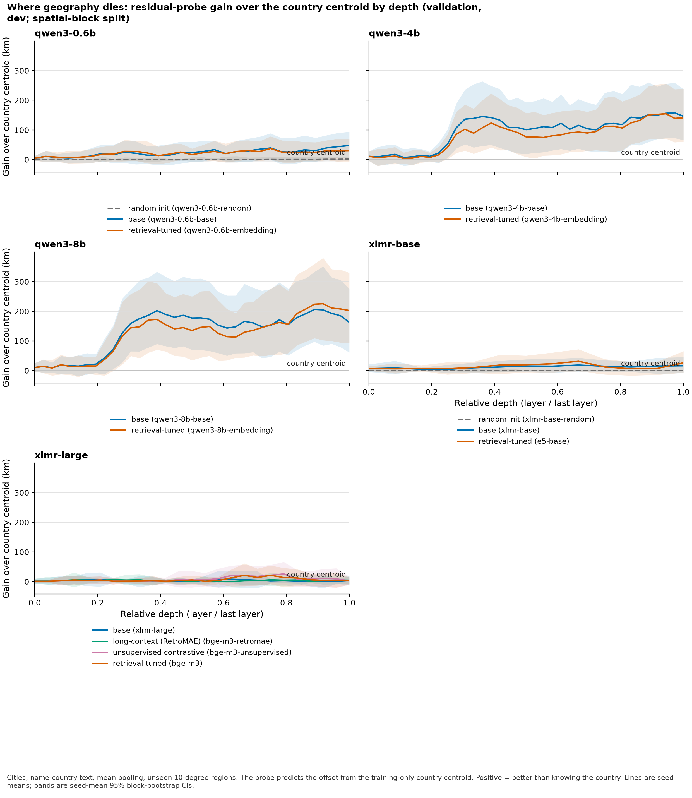
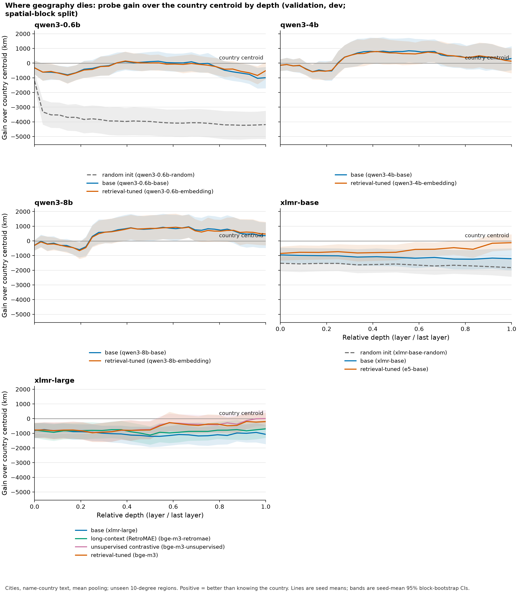
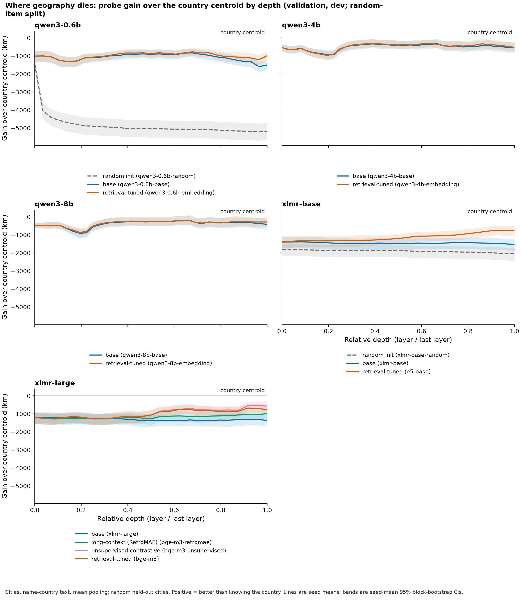
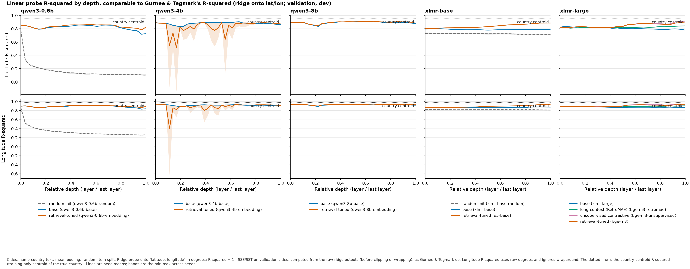
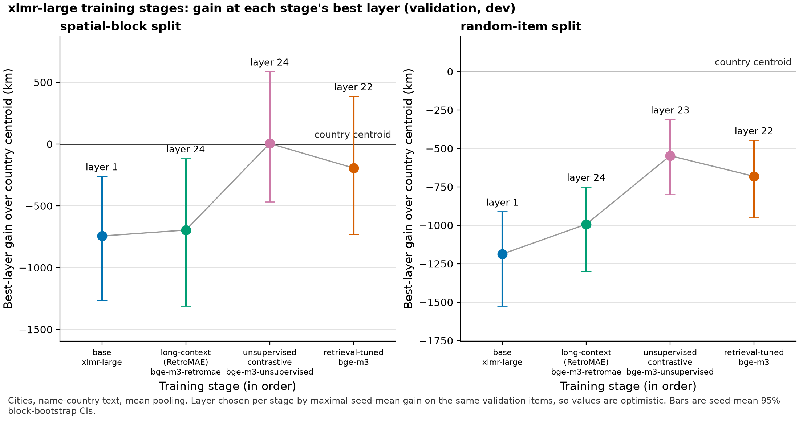

# Progress report — 2026-11-03

A plain-language summary of where the project stands, for the team. Technical run logs live in [`experiments/LAYERS_RUNS.md`](../experiments/LAYERS_RUNS.md); this page explains what they mean.

**Short version.** We built a pipeline that measures, layer by layer, how much geographic information is inside a language model, and ran it on 14 models (4 more are running now). Larger decoder models know where a city lies *within its country*, not just which country it is in, and retrieval training (turning a base model into a search-embedding model) does **not** throw that information away. Encoder models (XLM-R, E5, BGE-M3) show almost none of it. All numbers so far are on the **validation** split; the held-out **test** split has not been touched yet (see "Before the test run" below).

## Where the code is

| Branch | What it holds | Status |
|---|---|---|
| `master` | proposal, radio-station explorer, final-embedding location experiments | default branch |
| `ops/bc-cluster` | BC Andromeda cluster setup (`ops/bc.env`, `ops/README.md`) | pushed, not merged |
| `research/layer-probes` | layer-wise probing pipeline, first results | pushed, not merged |
| `research/probe-credibility` | **latest**: stronger probes, more models, this page, the project update | built on `research/layer-probes` |

To see everything: `git fetch && git checkout research/probe-credibility`.

## The question

The proposal asked whether text embeddings encode geography, and whether retrieval training removes geography that the base language model had. The earlier final-embedding experiments (on `master`) found that a linear probe on the *final* embedding barely beats "guess the centre of the station's country". That leaves two possibilities: the information is absent, or it is present in earlier layers and lost or hidden by the end. The layer-wise probes test this directly.

## What we built

- **Data.** 34,196 GeoNames cities (population at least 15,000) and 11,833 radio stations (Radio Browser snapshot of 2026-11-02). Cities are given to the model as text in two forms, `name` ("Lyon") and `name-country` ("Lyon, France"); stations use their metadata with coordinates removed.
- **Models (18 checkpoints).** Each family pairs a *base* model with a *retrieval-tuned* model whose model card names that base, so we can compare before and after retrieval training:

  | Family | Base | Retrieval-tuned | Status |
  |---|---|---|---|
  | Qwen3 0.6B | Qwen3-0.6B-Base (+ random-init control) | Qwen3-Embedding-0.6B | done |
  | Qwen3 4B | Qwen3-4B-Base | Qwen3-Embedding-4B | done |
  | Qwen3 8B | Qwen3-8B-Base | Qwen3-Embedding-8B | done |
  | Mistral 7B | Mistral-7B-v0.1 | e5-mistral-7b-instruct | running |
  | Gemma-2 9B | gemma-2-9b | bge-multilingual-gemma2 | running |
  | XLM-R base | xlm-roberta-base (+ random-init control) | multilingual-e5-base | done |
  | XLM-R large | xlm-roberta-large | BGE-M3 (three training stages: RetroMAE, unsupervised, final) | done |

  EmbeddingGemma is not in the probe study because Google has not released the checkpoint it was trained from.
- **Probes.** For every layer we average the hidden states over the text's tokens (and, for decoders, also take the last token), then fit a ridge regression that predicts the place's location. Three targets:
  - `sphere`: the location as a 3-D point on the unit sphere.
  - `latlon`: latitude and longitude in degrees, so R² is comparable with Gurnee & Tegmark.
  - `country-residual`: the offset from the country's centre. This asks "does the model know *where inside the country* this place is?" and is the most informative probe.
- **Controls.** The baseline everywhere is the *country centroid*: predict the average location of training places from the same country. Gains are reported in km over that baseline (positive = better than knowing the country). Random-init models show what a probe can extract from tokenization alone; shuffled-label probes show chance level.
- **Splits.** `random-item` holds out random places; `spatial-block` holds out whole 10° × 10° regions (harder: the probe must generalize to unseen parts of the map). Three seeds; 95% confidence intervals from a block bootstrap.
- **Validation vs. test.** Places are split 60/20/20 into train/validation/test. Every number below is validation. The test split will be run exactly once, after we decide which results the paper claims (see below).

## Results so far (validation only)

### 1. Within-country geography grows with model size, and retrieval training keeps it

Country-residual probe, `name-country` cities, km gain over the country centroid at each model's best layer, [95% CI]:

| Family | Base, random-item | Retrieval, random-item | Base, spatial-block | Retrieval, spatial-block |
|---|---|---|---|---|
| Qwen3 0.6B | 12 [-6, 31] | 24 [1, 48] | 48 [8, 94] | 48 [2, 100] |
| Qwen3 4B | 120 [68, 178] | 152 [90, 223] | 158 [73, 259] | 192 [83, 321] |
| Qwen3 8B | 175 [110, 254] | 201 [128, 285] | 206 [97, 333] | 226 [102, 380] |
| XLM-R base → E5 | 1 [-2, 4] | 3 [-13, 21] | 19 [-4, 43] | 31 [-2, 72] |
| XLM-R large → BGE-M3 | 1 [-3, 5] | 11 [-8, 32] | 8 [-19, 37] | 21 [-9, 54] |

Random-init controls are at about 1–4 km. In every Qwen size the retrieval model is at or above its base, but the CIs overlap, so the safe claim is "retrieval training keeps it", not "improves it". The same pattern holds for radio stations (Qwen3-8B: 170 base, 179 retrieval, random-item) and for name-only text when the probe is told the country.

**How to read it.** One panel per model family; x is relative depth (0 = embedding layer, 1 = last layer); y is km better than the country centroid; the band is the 95% CI. In Qwen3-4B and 8B the signal appears about a quarter of the way in and stays through the last layer. It is never discarded. XLM-R families stay flat at zero. (The title says "where geography dies" for historical reasons; the answer for decoders is "it doesn't".)

### 2. The vector you actually search with carries geography

Using the plain `sphere` probe on the retrieval models' own output vector (last token, last layer), Qwen3-Embedding-4B beats the country centroid by 231 km [30, 472] and Qwen3-Embedding-8B by 311 km [89, 565] (random-item). Mean-pooled `sphere` probes never beat the country centroid on random-item, which is why the earlier final-embedding experiments looked negative.

### 3. R² on latitude/longitude overstates what a model knows

Gurnee & Tegmark report R² of probes onto latitude and longitude. When the text names the country, the country centroid alone reaches R² = 0.95 (latitude) / 0.98 (longitude), and a *randomly initialized* Qwen3-0.6B reaches 0.78 / 0.87, so high R² mostly reflects knowing the country. The dotted line in each panel is the country-centroid R². This is our main critique of that paper and why the country-residual probe is the headline measure.

### 4. Where the probe puts each city

Grey dots are true city positions; arrows go from true to predicted position for 1,500 random validation cities (Qwen3-8B, layer 24). Base and retrieval models look very similar (median errors 842 km and 853 km). This is the prototype for the "distortion map" view in the interface.

### 5. BGE-M3 training stages

Best-layer `sphere` gain at each BGE-M3 training stage. The unsupervised-contrastive stage gives the largest jump, but the CIs are wide and all stages stay at or below the country centroid.

Full tables (every model, dataset, split, and probe) are in [`figures/layers-v3/summary.md`](figures/layers-v3/summary.md).

## Caveats

- **Validation numbers are optimistic.** The best layer and ridge strength are chosen on the same validation places they are scored on. The test run fixes this.
- **The country-centroid baseline is weak on station spatial-block splits.** When a country's main region is held out, its training centroid can come from a few distant stations, so station spatial-block gains partly reflect fixing a broken baseline. `summary.md` reports coverage.
- **Some Qwen3-4B-Embedding layers are unstable for the lat/lon probe.** In `r2-by-depth.png` a few middle layers dip sharply with large seed spread. This needs checking before we report lat/lon R² by layer.
- **Probes show the information is decodable, not that the model uses it** for retrieval.

## Running now

All 18 models are being rerun under one plan, `experiments/layers-v4.json`, so every result traces to the same configuration. This adds the Mistral-7B and Gemma-2-9B pairs, which test whether the Qwen pattern holds in other model families. Results are expected overnight; this page and its figures will be refreshed on 2026-11-04.

## Before the test run

The test split can be used only once. Before running it, the team agrees on a short list of exactly which results the paper claims (model, dataset, text form, pooling, probe, layer), commits that list, and only then runs the test. A draft list will be circulated after the v4 results.

## Next steps (proposed owners; see the project update)

| When | What | Owner |
|---|---|---|
| Nov 4–10 | Freeze the test list; run the held-out test once; export per-region scores | Tian-hao Zhang |
| Nov 11–24 | Retrieval proximity metrics (Spearman ρ, overlap@10, excess distance, random baseline) | Nathan Chen |
| Nov 11–24 | Layer-by-region map view, linked to the globe explorer | Artem Frenk |
| Nov 25–Dec 6 | Case studies and expert walkthrough of the views | Kenta Ploch |
| Dec 7–20 | Paper; audio and adapter only as stretch goals | everyone |

The project update draft is in [`paper/update/TeamN.tex`](../paper/update/TeamN.tex).

## Reproducing

Cluster setup: [`ops/README.md`](../ops/README.md) (BC Andromeda section). Run logs, job IDs, plan hashes, and checksums: [`experiments/LAYERS_RUNS.md`](../experiments/LAYERS_RUNS.md). Design and plan: [`docs/superpowers/specs/2026-11-02-layerwise-probes-design.md`](superpowers/specs/2026-11-02-layerwise-probes-design.md) and [`docs/superpowers/plans/2026-11-02-layerwise-probes.md`](superpowers/plans/2026-11-02-layerwise-probes.md). Extracted features (about 370 GB) and raw outputs are not in git; they are on the cluster under `/projects/weilab/zhangdjr/ComeALittleCloser`.
